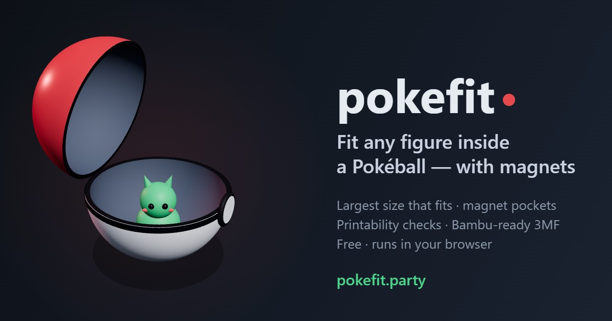

# pokefit

**https://pokefit.party** — fit any 3D-printable figure inside a printed Pokéball, with magnets.



pokefit takes a figure (3MF, STL, OBJ or GLB — a GLB's texture or material colours become filaments) and:

- scales it to the **largest size that fits** the ball's inner sphere, connector rings and ring opening
  (60 % or 100 % ball, or any inner diameter);
- cuts **1–3 magnet pockets** (4 × 2 mm discs) into its underside — flat feet or not — so it snaps onto a
  **steel washer** glued inside the ball (magnets rest on the washer; optionally raised into floating parts),
  and compares washers;
- **shapes the figure for the ball**: legs or a tail lying straight out past the washer are bent up along the
  sphere so it fits larger (automatic for limbs, more for wide, low figures, only when it helps), and the base is
  made flat over the washer (18 mm, or any diameter): low bumps pressed flat (≤ 1.2 mm), gaps under the body up to
  2.5 mm filled with a solid flat base (round the washer, or only inside a circle you place under the body), so
  magnets have room and the belly needs no support. Paint and texture colour are kept (only vertices move; the
  flat base is its own part);
- **strengthens thin parts** (optional): ears, tail tips and flames get a minimum thickness where they join the
  figure, tapering toward their tips; a thin neck between two bigger parts (a small tail tip under a big flame)
  gets it all along;
- **colours single-colour models**: tap the 3D view and each tap fills a part found from the shape (ears, tail,
  eyes, bib…), a separate piece or a brush patch; drag the brush to draw outlines, and a fill stops at a painted
  outline, so eyes or a belly with no crease round them can be painted too. Mirror paints both sides at once
  (both eyes in one tap), Grow/Shrink adjust the last step, Pick colour, Undo/Redo, and specks too small to print
  are dropped. Exported as Bambu paint;
- **simplifies dense meshes** (optional, like Bambu Studio's Simplify) when they load: a 1.45M-triangle sculpt
  at 100k opens 3x faster, paints and exports 10-25x faster, with the surface moved by under 0.02 mm;
- **remembers your settings** (ball, washer, magnets, height, shape, simplify) in your browser, and lets you set them before
  opening a figure;
- **checks printability**: closed mesh, wall thickness, overhangs, floating layers, bed contact;
- **exports a Bambu Studio 3MF** that keeps painted colours, plus a variant renumbered to your own project's
  filament slots for *Import geometry only*;
- **shows what colours cost to print**: estimated filament changes, time and purge for the figure and for
  every palette size (on a two-nozzle X2D/H2D, two colours need no filament changes at all), from a model
  calibrated on Bambu slices;
- **matches colours to your printer's AMS** (local version, through [beambam](https://github.com/tribixbite/beambam)):
  reads the loaded filaments, maps the figure's colours to them and can recolour the figure to match;
- **shows your printer** (local version, beambam): live camera, progress, nozzle and bed temperatures — read-only;
- **takes models from other apps**: a page can open pokefit and post a model to it (`pokefit:load`, see
  `web/src/handoff.ts`), or link `https://pokefit.party/?url=<model>`;
- **reads your Bambu Studio presets**: a project 3MF, or the preset exports from *File › Export › Export Preset
  Bundle* (`.bbscfg` printer bundle, `.bbsflmt` filament bundle, printer/filament/process presets `.zip`). Their
  filaments become materials to print with, their process presets selectable settings; a filament that cannot
  print on your project's plate is flagged (Bambu would refuse to slice it).

The website runs the whole engine **in your browser** (Python → WebAssembly via Pyodide); files are never
uploaded. The local version adds **Bambu Studio slicing** (print time and filament for 1 and 10 copies, supports,
and the sliced **print file** — `.gcode.3mf` with thumbnails — ready to send to the printer)
and **photos to 3D**: photos of a toy from the front, left and back become a coloured, printable model, made on
your own GPU by [Pixal3D](https://github.com/TencentARC/Pixal3D) in a local ComfyUI (setup in `AGENTS.md`, "Photos to
3D"; about 3–4 minutes on a 16 GB laptop GPU):

```sh
python -m pokefit photos --front front.png --left left.png --back back.png --out figure.glb
python -m pokefit photos --photo any-angle.jpg --out figure.glb      # one photo works too
python -m pokefit fit figure.glb --out out/            # or "Make one from photos…" in the local web UI
```

## Local use

Needs Python 3.11+ and [bun](https://bun.sh); Bambu Studio for slicing.

```sh
pip install -e .            # add ".[full]" for the self-intersection check
cd web && bun install && bun run build && cd ..
python -m pokefit serve --open                       # web UI at http://127.0.0.1:8765
python -m pokefit fit figure.3mf --diameter 44 --magnets 2 --washers --out out/ --slice --x10
```

The ball's measurements ship with the package. The ball model itself (MakerWorld
[#2045372](https://makerworld.com/en/models/2045372), not redistributed here) is only needed for the
washer-seat bottom shell: put `pokeball.3mf` in the repo folder, or load it on the website.

## Development

| | |
|---|---|
| Python engine | `pokefit/` — `pipeline.py` (analysis), `fit.py`, `magnets.py`, `checks.py`, `model3mf.py`, `webapi.py` (browser entry) |
| Web UI | `web/src/` — `main.ts`, `scene.ts` (three.js), `underside.ts`, `api.ts` (local server or worker), `worker.ts` (Pyodide) |
| Gates | `python -m mypy && python -m pytest`, `cd web && bun run typecheck && bun test && bun run build && bun run smoke` |
| Social preview | `cd web && bun run og`, open the printed URL (writes `public/og.gif`, `public/og.jpg`) |

Every push to `main` runs the gates and deploys `web/dist` to GitHub Pages (`.github/workflows/deploy.yml`).

## Licence

pokefit is free software under the [GNU Affero General Public License v3.0](LICENSE) or (at your option) any
later version, the same licence as [beambam](https://github.com/tribixbite/beambam). If you run a modified
version as a website, offer its users the source (AGPL section 13).

pokefit is a fan-made tool, not affiliated with or endorsed by Nintendo, Game Freak, Creatures or The Pokémon
Company. Pokémon and Poké Ball are trademarks of their respective owners.
